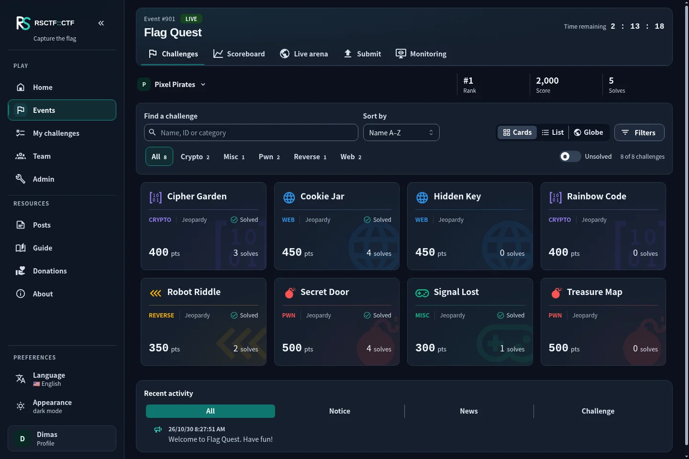
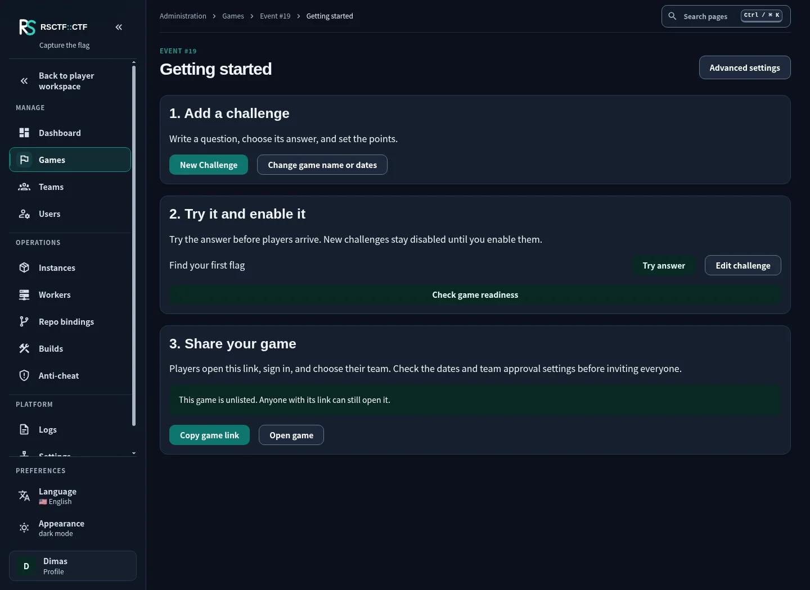
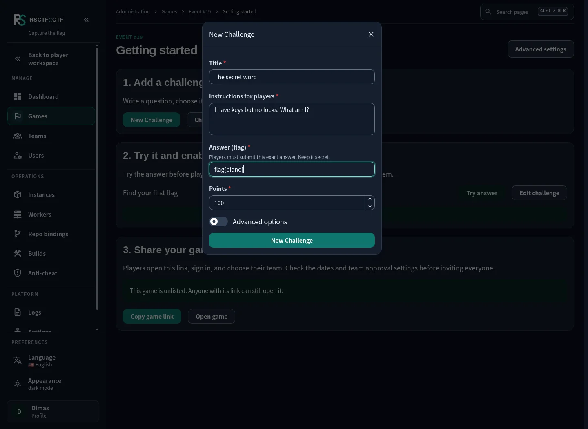
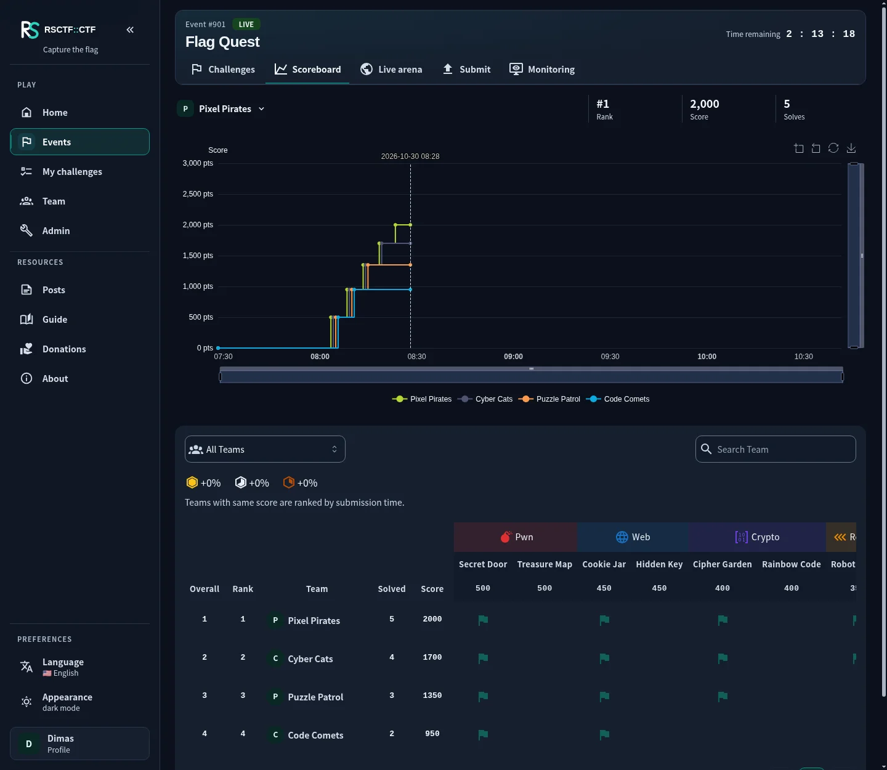

# RSCTF

**Turn puzzles into a game. Play with friends. Watch your team climb the scoreboard.**

Pick a challenge, find its secret answer (a *flag*), and earn points.



## Start here

On a Linux machine, paste this into a terminal. The installer helps you set up Docker too.

```bash
curl --proto '=https' -fsSL https://github.com/dimasma0305/rsctf/releases/latest/download/install.sh | bash
```

1. Press **Enter** to try it on your computer, or choose **Public server** to share it online.
2. Open the link and paste the setup code shown by the installer.
3. Create your admin account. You're ready!

[Installation help](docs/getting-started/install-wizard.md) · [Verify the installer](docs/reference/installer.md#verify-the-installer-before-execution)

## Make your first game

Open **Admin → Games → Create sample game**. Follow three small steps:



**Have your own puzzle?** Give it a name, write a question, and choose the answer.



## Play together

Share your game link. Invite friends to a team. Solve puzzles and cheer each other on.



*Real RSCTF screens with sample data.* [Player guide](docs/players/accounts-and-teams.md) · [Run an event](docs/organizers/index.md)

## Keep it running

From your installed `rsctf` folder: **`./rsctf update`** updates the app; **`./rsctf backup`** saves a backup.

[Daily backups & restore](docs/deploy/operations.md) · [Advanced game modes & deployment](deploy/README.md) · [All guides](docs/index.md)

Want to build or contribute? See [CONTRIBUTE.md](CONTRIBUTE.md).

Free and open source. [MIT License](LICENSE.txt) · [Licensing](LICENSING.md) · [NOTICE](NOTICE)
