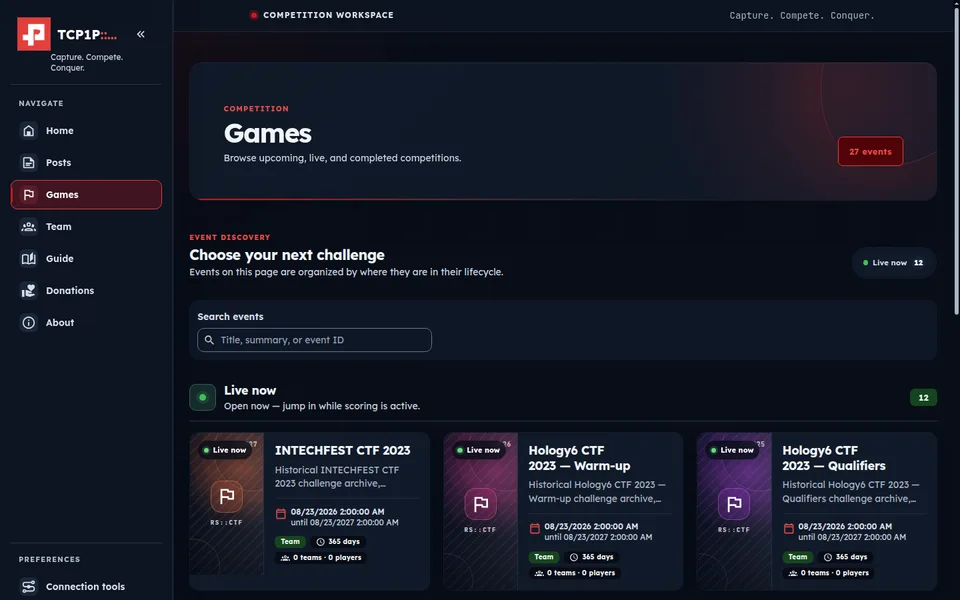

# RSCTF

Run your own Capture-the-Flag (CTF) competition. Create challenges, invite players,
and follow their scores.

## Install

Use a Linux machine with [Docker Engine and Docker Compose](https://docs.docker.com/engine/install/) installed.

Run this command in a terminal:

```bash
curl --proto '=https' -fsSL https://github.com/dimasma0305/rsctf/releases/latest/download/install.sh | bash
```

1. Press **Enter** to try it locally. For a public website, choose **Public server** and enter your domain.
2. Open the setup link printed by the installer.
3. Paste the displayed code into **Setup token** and create your administrator account.

Docker creates the setup code automatically. The installer shows it for you;
you can also find it in the Docker logs while setup is unfinished.

See the [installation guide](docs/getting-started/install-wizard.md) for help.
The command downloads the installer over HTTPS; [verification before execution](docs/reference/installer.md#verify-the-installer-before-execution) is also available.

## Run your first game

1. Open **Admin → Games** and create a game with a future start time.
2. Add a challenge and its answer (the flag), test it, and enable it.
3. Share the game link with your players.

Follow the [first-event guide](docs/organizers/index.md) to test and publish it.

<p align="center">
  
</p>

## What you can run

- **Jeopardy:** players solve challenges and submit flags for points.
- **Attack & Defense:** teams protect their services and attack other teams.
- **King of the Hill:** teams compete to control a shared target.

RSCTF includes accounts, teams, scoreboards, event management, and optional
cheat review, AI chat disclosures, and solver uploads.

## Help

- [Player guide](docs/players/accounts-and-teams.md)
- [Organizer guide](docs/organizers/index.md)
- [Advanced deployment](deploy/README.md), including containers, workers, and VPN
- [Backups and updates](docs/deploy/operations.md)
- [All documentation](docs/index.md)

## Contributing

To change RSCTF itself, see [CONTRIBUTE.md](CONTRIBUTE.md) for development setup,
source builds, tests, repository layout, and publishing.

## License

RSCTF is free and open-source software under the [MIT License](LICENSE.txt).
See the [licensing guide](LICENSING.md) and [NOTICE](NOTICE) for details,
including the vendored [CreepJS MIT license](web/src/lib/creepjs/LICENSE).
